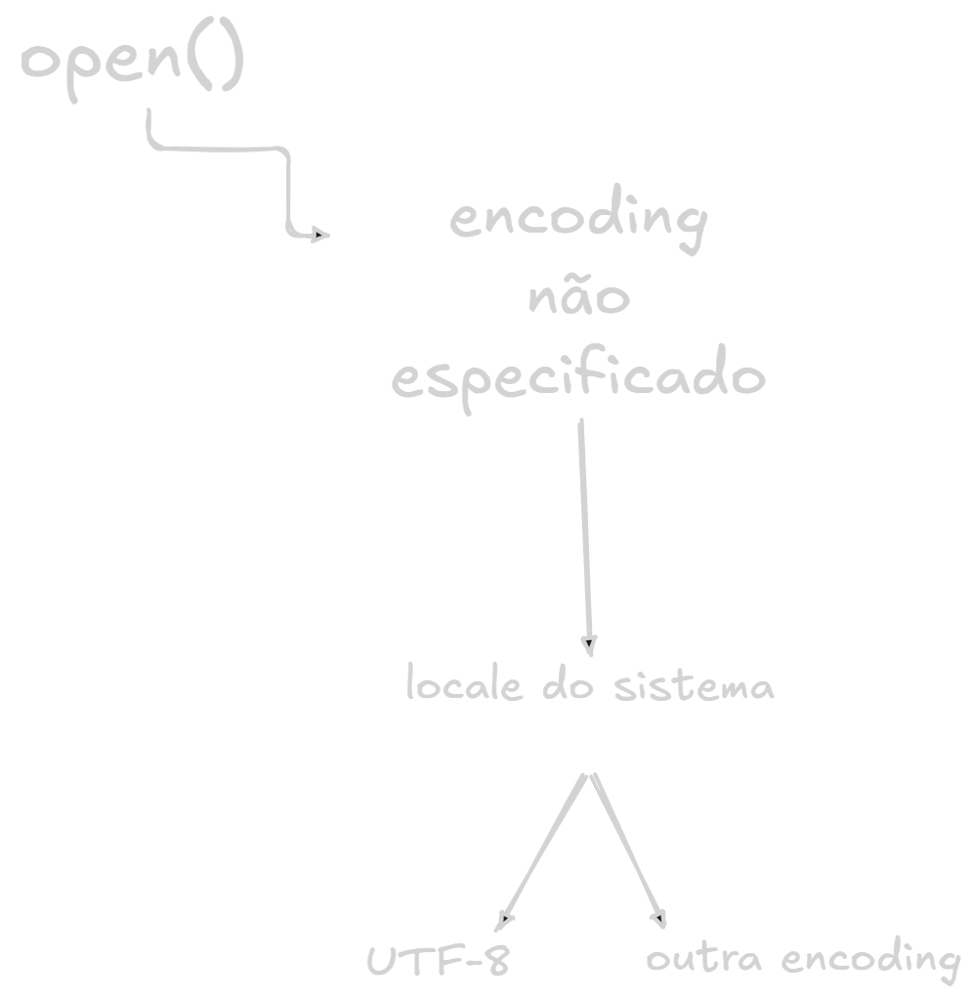
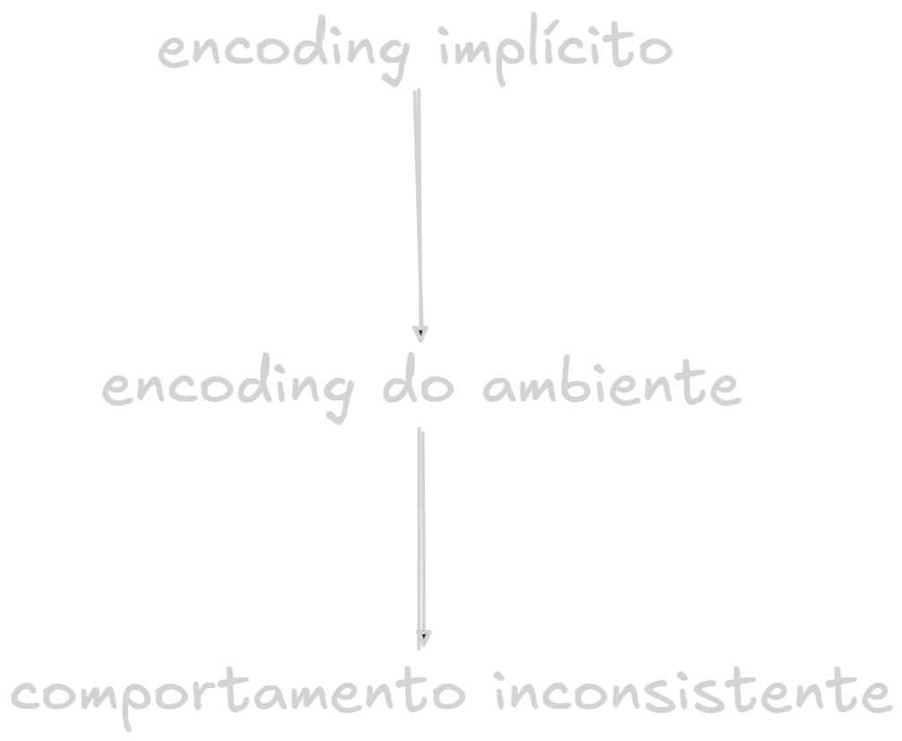
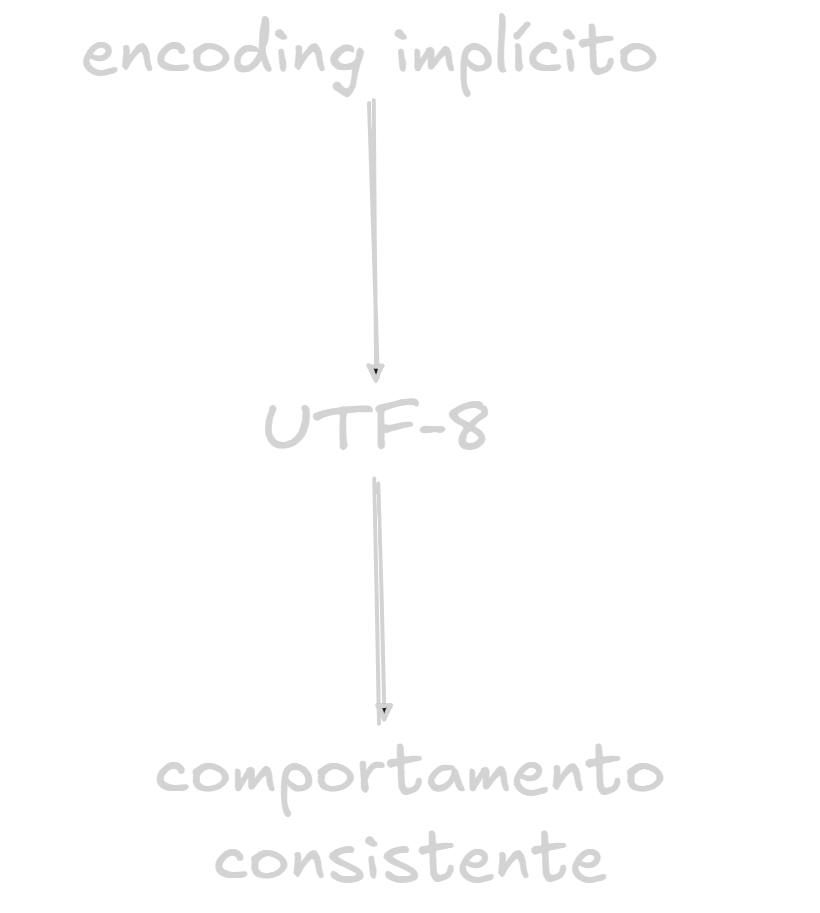

## Introdução

> TL;DR: A maioria dos brasileiros já se deparou com um 'ç' virando 'ç' alguma vez na vida. O Python 3.15 "conserta" isso, e quebra outra coisa no mesmo movimento.

Existe uma categoria de bugs que parece sobrenatural para quem está começando a programar. Imagine a seguinte situação: Você termina de escrever aquele script que lê os dados de um arquivo.

Funciona no Linux. Funciona no macOS. É enviado para produção e então alguém abre o sistema no Windows e aparece:

```markdown
Configuraç£o
Informações
Usuário
```

O problema não está necessariamente no texto, mas sim na forma como os `bytes` foram interpretados. E esse é exatamente o tipo de problema que o **Python 3.15** começa a atacar diretamente.

## O bug histórico

Durante muito tempo, Python deixou que o sistema operacional decidisse qual `encoding` utilizar quando você não especificava um explicitamente.

Dessa forma:

```python
with open('arquivo.txt') as file:
	content = file.read()
```

Poderia retornar um resultado diferente de acordo com o sistema em que esse código fosse executado. O `open()` utilizava o `encoding` associado ao `locale` quando `encoding` não era informado. Em sistemas Unix modernos, isso frequentemente significava **UTF-8**. No Windows, porém, o resultado poderia ser uma `code page` específica do sistema.

Isso criava uma situação particularmente perigosa:

```python
open('arquivo.txt')
```

Esse trecho não representava necessariamente a mesma operação em todas as máquinas. Imagine um arquivo salvo como **UTF-8** contendo a string: _"Informação"_.

Essa palavra contém caracteres que não pertencem ao conjunto **ASCII** básico. Em **UTF-8** por exemplo, o caractere `ç` é representado por mais de um `byte`. Se esses `bytes` forem interpretados utilizando outro `encoding`, o resultado pode ser algo completamente diferente, como o famoso _"ç"_.

Não houve nenhuma alteração mágica no arquivo, os `bytes` continuam sendo os mesmos. O problema ocorreu na camada de **decodificação**.

## Bytes não são texto

Essa distinção é fundamental. Computadores armazenam `bytes` (`48 65 6C 6C 6F`). Nós interpretamos esses `bytes` como texto utilizando uma codificação. Por exemplo:

```markdown
UTF-8
ASCII
Windows-1252
ISO-8859-1
UTF-16
```

O mesmo conjunto de `bytes` pode produzir resultados diferentes dependendo da codificação utilizada. É por isso que `bytes_data.decode('utf-8')` é diferente de `bytes_data.decode('cp1252')`. A codificação não está necessariamente _"dentro"_ do texto, ela é uma regra utilizada para interpretar `bytes`. E aqui está a raiz de boa parte dos problemas históricos de `encoding` em aplicações Python: `open('arquivo.txt')` delegava essa decisão ao ambiente ao invés de tratar ele.

## O que Python fazia antes do 3.15?

Historicamente, o comportamento era aproximadamente:



Em Linux configurado com **UTF-8** `open('arquivo.txt')` provavelmente utilizaria **UTF-8**. Em outro ambiente, poderia utilizar uma codificação diferente.

Esse _"provavelmente"_ é justamente o problema. Software portátil não deveria depender de uma configuração implícita da máquina para interpretar seus próprios arquivos.

## Python 3.15 muda o padrão

É aqui que entra a [PEP 686 - Make UTF-8 mode default](https://docs.python.org/3.15/whatsnew/3.15.html#whatsnew315-utf8-default). A partir do **Python 3.15**, o **UTF-8 Mode** passa a ser habilitado por padrão, consequentemente, operações de I/O que não especificam explicitamente um `encoding` passam a utilizar **UTF-8**.

Então o trecho que antes era:

```python
with open('arquivo.txt') as file:
	content = file.read()
```

Passa a significar na prática quando nenhum encoding é fornecido:

```python
with open('arquivo.txt', encoding='utf-8') as file:
	content = file.read()
```

Isso também vale para outras operações de I/O que dependem desse comportamento padrão. A motivação é bastante simples: **UTF-8 deixou de ser apenas mais uma codificação** e tornou-se o **padrão de facto da internet**, de formatos modernos de arquivo e de grande parte do ecossistema de software.

## Então Python finalmente corrigiu o problema?

**Sim, mas não completamente.** E aqui está a parte interessante:

O Python 3.15 corrige uma inconsistência de portabilidade, mas também altera o comportamento de aplicações existentes. Considere esse código:

```python
with open('arquivo.txt') as file:
	data = file.read()
```

O desenvolvedor pode ter pensado: _"Esse arquivo é padrão UTF-8"_, quando talvez, o arquivo não seja **UTF-8**. Talvez ele seja um arquivo legado gerado por um ERP, ou até uma exportação de um sistema Windows antigo. Talvez ele seja `cp1252`, ou `latin-1`. Talvez o programa tenha sido escrito justamente esperando o `encoding` do sistema.

Nesse caso, o **Python 3.15** não está _"consertando"_ o problema, ele está mudando uma suposição implícita que o programa fazia, e isso pode resultar em: `UnicodeDecodeError` onde antes a aplicação funcionava.

## O bug não desapareceu, só mudou de lugar

Essa é, na minha opinião, a parte mais importante dessa mudança.

Antes tínhamos:


Com o Python 3.15 teremos:


A segunda situação é claramente melhor para software moderno, mas ainda existe uma pergunta que o Python não pode responder por nós:

> Qual o `encoding` real dos dados que estamos consumindo?

Se um sistema externo produz `cp1252`, não adianta o Python decidir que o mundo inteiro deveria ser **UTF-8**.

O problema passa a ser explicitamente nosso, e isso é uma coisa boa.

## O que acontece com o `open()`?
